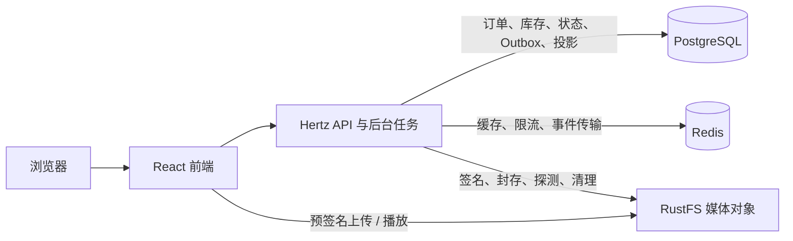

# TokMall

**TokMall 是一个把短视频浏览和商品交易串起来的 Go 全栈学习项目。** 作者上传视频、挂上自己的商品；买家刷视频时从商品卡下单，完成模拟支付、发货、确认或全额退款。系统会记录视频带来的成交，并通过对账检查订单、库存、事件和统计是否一致。

项目面向后端学习和面试，重点练习并发交易、幂等、缓存、异步事件和故障恢复。后端用 Hertz，前端用 React，架构是共享 PostgreSQL 的模块化单体。支付、发货、退款都是模拟操作。

## 一个使用场景

1. 创作者注册，创建商品和 SKU（可购买的规格与价格），补库存。
2. 上传视频，等媒体校验通过后发布，再挂上自己的在售商品。
3. 另一位用户在 Feed 里看到商品卡，进入详情下单。
4. 买家模拟支付，创作者模拟发货，买家确认完成。
5. 订单完成前，买家可以申请全额退款，由商家同意或拒绝。
6. 创作者查看成交统计；后台用事件消费和对账检查异步统计是否完整。

```text
内容：上传 → 封存 → 媒体校验 → 发布 → 挂商品 → Feed
交易：商品卡 → 单 SKU 下单 → 模拟支付 → 模拟发货 → 确认完成（到期自动确认）
售后：已付款未完成 → 申请全额退款 → 同意 / 拒绝并恢复（到期未处理自动同意）
后台：交易事实 + Outbox → Redis Streams → 回执与日销投影 → 对账
```

**还没做的：**
- 网页没有优惠券和热榜入口（后端已实现）。
- 购物车、多 SKU、真实支付物流、部分退款、退货入库都不在 v1 范围。

详见 [业务规则](docs/business.md#gaps)。

## 后端重点解决的问题

| 问题 | 做法 | 入口 |
|---|---|---|
| 并发下单如何不超卖、重试如何不重复？ | 订单与库存同事务，条件扣减，幂等键加请求指纹，数据库约束兜底；热点库存放在事务尾部 | [订单仓储](internal/order/repository.go)、[PG 并发测试](internal/order/postgres_integration_test.go) |
| 翻页和缓存命中后数据如何保持正确？ | 签名时间游标，L1/L2 + singleflight + 版本号，点赞和商品卡按页合并读取 | [Feed 服务](internal/feed/service.go)、[新鲜度测试](internal/feed/dynamic_read_integration_test.go) |
| 交易成功了，事件或统计没完成怎么办？ | 事实与 Outbox 同事务，至少一次投递，幂等消费，按确认水位安全裁剪，九项对账 | [事件传输](internal/outbox/transport.go)、[对账](internal/reconcile/repository.go) |
| 上传如何防替换，删除失败如何恢复？ | staging 直传，大小核验，ETag 条件封存，媒体门禁，持久化删除任务 | [视频服务](internal/video/service.go)、[存储测试](internal/storage/upload_integration_test.go) |
| 怎么证明优化有效？ | k6 三轮交错对照，锁等待现场采样，pprof，压完核对账本和投影 | [性能](docs/performance.md)、[诊断归档](benchmarks/2026-10-11/diagnosis/README.md) |

## 系统组成



后端：Go、Hertz、GORM、golang-migrate、JWT、slog、Prometheus。前端：React、TypeScript、TanStack Router/Query、Vite、Tailwind。后台任务（媒体探测、订单到期、事件中继与消费、对账、对象清理）和 API 同进程运行。没有 Kafka、没有微服务、没有完整 OpenTelemetry。

## 本地启动

需要 Go（版本见 [go.mod](go.mod)）、Node 22、pnpm（版本见 [web/package.json](web/package.json)）和 Docker/Compose。真实媒体校验需要 ffprobe/ffmpeg，缺失时视频会标记为"跳过校验"。

```bash
cd web && pnpm install --frozen-lockfile && cd ..
make dev
```

`make dev` 会启动 PostgreSQL、Redis、RustFS，构建并启动后端和前端；API 启动时自动执行迁移。

| 入口 | 地址 |
|---|---|
| 网页 | http://localhost:5173 |
| API | http://localhost:8080/api/v1 |
| OpenAPI | http://localhost:8080/api/v1/docs/openapi.yaml |
| 指标 | http://127.0.0.1:9091/metrics |
| RustFS 控制台 | http://localhost:9001 |

日志、停机、端口、Docker 凭证问题见 [运维](docs/operations.md)。

## 第一次演示

用两个浏览器会话，分别扮演卖家和买家：

1. **卖家**：注册，在个人页创建商品、SKU 并补库存；上传一个 1～512 MiB 的可播放视频（如 H.264 MP4）。
2. **卖家**：等校验通过后发布视频，在视频详情页挂上商品。
3. **买家**：从首页商品卡进入详情，下单并模拟支付。
4. **卖家**：在订单页"我销售的"模拟发货。
5. **买家**：在"我购买的"确认完成。演示退款时另建一单，在确认前申请，再由卖家处理。
6. **卖家**：查看个人页成交统计；技术侧用 `make outbox-status` 和 `make reconcile` 检查事件与账实一致。

## 验证

```bash
go test ./...      # 默认跳过真实依赖测试
make lint
make verify        # fmt / vet / lint / test / tidy-check
cd web && pnpm typecheck && pnpm exec vitest run
```

真实 PG/Redis/RustFS 测试的开关和 E2E 见 [运维](docs/operations.md#测试)。

## 文档

| 文档 | 回答什么 |
|---|---|
| [业务规则](docs/business.md) | 用户能做什么、订单/退款/券的规则、哪里还没闭环 |
| [架构](docs/architecture.md) | 每个子系统怎么实现、为什么这样选、代价是什么 |
| [运维](docs/operations.md) | 启动、迁移升级、测试、观测、对账恢复 |
| [性能](docs/performance.md) | 压测数据与适用范围、下一步压测计划、怎么跑压测 |
| [路线图](docs/roadmap.md) | 未完成的工作和进入条件 |
| [面试清单](docs/interview.md) | 30 道题的答题要点与证据 |
| [前端](web/README.md) | 网页接入范围、类型生成、前端测试 |
| [AGENTS.md](AGENTS.md) | 改代码时必须遵守的约束 |

以上每个事实只写在一个地方。改代码时只更新"负责"这件事的那份文档，其他文档用链接引用。事实最终以 [main.go](cmd/api/main.go)、[OpenAPI](internal/api/openapi.yaml)、[migrations](migrations/)、[config.go](internal/config/config.go) 为准。
