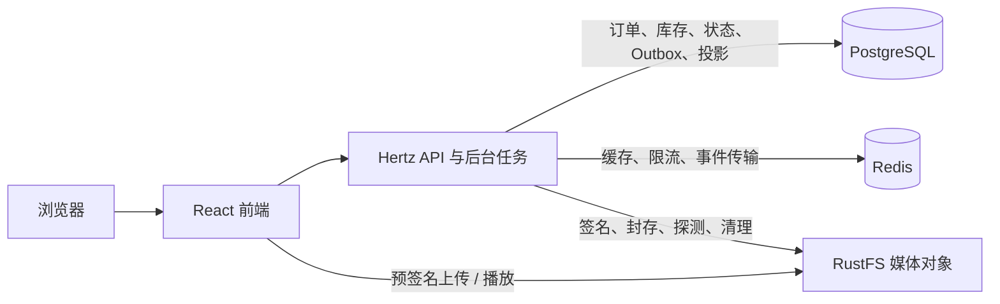

# TokMall

**TokMall 是一个把短视频浏览与商品交易串起来的 Go 全栈个人项目。** 作者上传视频、挂载自己的商品；买家刷视频时从商品卡下单，完成模拟支付、发货、确认完成或全额退款。项目还会记录视频带来的成交，并检查订单、库存、事件和统计是否一致。

它面向后端学习和项目面试，重点实践并发交易、幂等、缓存、异步事件与故障恢复。后端采用 Hertz，前端采用 React；当前是共享 PostgreSQL 的模块化单体。支付、发货和退款都是模拟业务操作，不涉及真实资金或配送。

## 从一个使用场景认识项目

假设一位创作者想通过视频介绍自己的商品：

1. 注册账号，创建商品、SKU（可购买的规格与价格）并补充库存。
2. 上传真实视频，等待媒体校验后发布，再挂上自己的在售商品。
3. 另一位用户在视频中看到商品卡，进入详情并下单。
4. 买家模拟支付，创作者在销售订单中模拟发货，买家确认完成。
5. 若订单尚未完成，买家可以申请全额退款，由商品所有者裁决。
6. 作者查看成交统计；后台通过事件消费和对账检查异步统计是否完整。

同一账号可以发布内容、管理自己的商品和购买他人的商品。作者、买家、商家是业务身份，当前以用户 ID 和资源归属授权，没有完整的平台角色与店铺权限体系。

```text
内容：上传 → 封存媒体 → 校验 → 发布视频 → 挂载商品 → Feed 浏览
交易：商品卡 → 单 SKU 下单 → 模拟支付 → 模拟发货 → 确认完成
售后：已付款且未完成 → 申请全额退款 → 同意退款 / 拒绝并恢复原状态
后台：交易事实 + Outbox 事件 → Redis Streams → 消费回执与日销投影 → 对账
```

## 现在能体验什么

| 范围 | 当前能力 |
|---|---|
| 网页内容链路 | 注册登录、上传、作者发布、媒体状态与拒绝原因、全局/关注视频流、点赞关注、公开作者主页 |
| 网页交易链路 | 创建商品/SKU、补库存、挂载商品、购买、买卖双方订单、模拟履约、全额退款、作者成交总计 |
| 后端额外能力 | 商家满减券、独立热榜、商品搜索与状态管理、作者统计拆分、事件投影及恢复工具；部分接口尚无网页入口 |
| 工程验证 | 真实 PostgreSQL 并发测试、Redis/RustFS 契约测试、OpenAPI 检查、前端测试、压测与业务对账 |

当前网页尚无发券/领券/结账选券流程和热榜入口。作者成交页面读取订单事实的实时统计；后台日销投影是另一条异步链路，不把两者当成同一个查询。

v1 只支持单 SKU 订单、一单一张同商家满减券、完成前的全额退款。未发货退款回补库存，已发货退款不回补，确认完成后不接受退款。购物车、多 SKU/跨商家订单、真实支付与物流、退货入库、部分退款、佣金结算、评论/通知和平台治理等能力尚未实现。完整规则见 [商城业务](docs/commerce-business.md)，前端范围见 [web README](web/README.md)，后续工作见 [roadmap](docs/roadmap.md)。

## 后端重点解决的问题

| 工程问题 | 项目做法 | 代码与验证入口 |
|---|---|---|
| 并发下单如何不超卖、重试如何不重复扣库存？ | 订单与库存同事务，条件扣减、幂等键与请求指纹、数据库约束；热点库存更新放在事务尾部 | [订单仓储](internal/order/repository.go)、[真实 PG 并发测试](internal/order/postgres_integration_test.go) |
| 翻页和缓存命中后，数据如何保持正确？ | 时间游标、HMAC、L1/L2、singleflight；点赞和商品卡按请求合并读取 | [Feed 服务](internal/feed/service.go)、[动态数据新鲜度测试](internal/feed/dynamic_read_integration_test.go) |
| 交易已成功，事件或统计没完成怎么办？ | 事实与 Outbox 同事务、至少一次投递、幂等消费、安全保留与背压、九项对账 | [事件传输](internal/outbox/transport.go)、[对账](internal/reconcile/repository.go) |
| 上传文件如何防替换，删除失败如何恢复？ | 临时对象直传、大小核验、ETag 条件封存、媒体门禁、持久化删除任务 | [视频服务](internal/video/service.go)、[真实存储测试](internal/storage/upload_integration_test.go) |
| 性能优化如何证明有效？ | 固定实验条件、k6、多轮对照、实时锁等待采样与 pprof，核对同步账本和异步投影 | [性能证据](docs/performance-baseline.md)、[诊断归档](benchmarks/2026-10-11/diagnosis/README.md) |

性能记录包含本机同条件 Feed 对照和热点交易优化，也记录了失败档、消费积压与测试限制。具体数字和适用范围统一看性能文档，不把历史吞吐当作生产容量。

## 系统如何运行



- **PostgreSQL** 保存业务事实，订单与库存使用本地事务；表结构由 SQL 迁移管理。
- **Redis** 提供缓存、限流、刷新令牌撤销、热榜和 Streams 消息传输。
- **RustFS** 提供 S3 兼容对象存储，视频不经 API 转发上传。
- **后台任务** 与 API 同进程运行，处理媒体探测、过期订单、事件投递/消费、对账与对象清理。

后端主要使用 Go、Hertz、GORM、golang-migrate、JWT、slog 和 Prometheus；前端使用 React、TypeScript、TanStack Router/Query、Vite 和 Tailwind。没有部署 Kafka/RabbitMQ 或拆分微服务；traceparent 与日志关联不等于完整 OpenTelemetry 链路。模块关系见 [后端架构](docs/backend-architecture.md)。

## 本地启动

准备 Go（版本要求见 [go.mod](go.mod)）、Node 22、pnpm（版本见 [web/package.json](web/package.json)）及运行中的 Docker/Compose。真实媒体校验需要 ffprobe/ffmpeg；工具缺失会标记为跳过校验，不能据此证明媒体通过验证。

从项目根目录执行：

```bash
cd web
pnpm install --frozen-lockfile
cd ..
make dev
```

`make dev` 启动 PostgreSQL、Redis、RustFS，构建并启动后端与前端。API 启动时自动执行迁移，无需手工建表；Makefile 提供仅用于本地开发的密钥和凭证。

| 入口 | 地址 |
|---|---|
| 网页 | http://localhost:5173 |
| API | http://localhost:8080/api/v1 |
| OpenAPI 契约 | http://localhost:8080/api/v1/docs/openapi.yaml |
| 指标 | http://127.0.0.1:9091/metrics |
| RustFS 控制台 | http://localhost:9001 |

启动日志看 `make logs` 或 `logs/api.log`、`logs/web.log`。`make stop` 按 `bin/api`/Vite 进程匹配强制停止应用，数据容器继续运行；优雅退出、端口冲突、Docker 凭证助手和旧部署升级见 [开发与运维](docs/development-and-operations.md)。

## 第一次演示怎么走

使用两个账号，或两个浏览器会话分别扮演卖家和买家：

1. **卖家**：注册后进入个人页，创建商品、SKU并补库存；从上传入口上传可播放、1MiB～512MiB的视频（例如H.264编码的MP4）。
2. **卖家**：在个人页或视频详情等待校验结果，通过后发布视频，再在自己的视频详情挂商品。
3. **买家**：从首页视频商品卡进入商品详情，创建订单并模拟支付。
4. **卖家**：进入订单页的“我销售的”，模拟发货。
5. **买家**：在“我购买的”确认完成。要演示退款，请另建一单，在确认完成之前申请退款，再由卖家同意或拒绝。
6. **卖家**：查看个人页的成交统计；技术侧可通过 `make outbox-status` 和 `make reconcile` 检查事件与账实一致性。

## 开发验证与阅读顺序

```bash
go test ./...                    # 默认跳过真实依赖集成测试
make lint                        # golangci-lint 配置见 .golangci.yml
make verify                      # fmt / vet / lint / test / tidy-check
cd web
pnpm typecheck
pnpm exec vitest run
```

真实 PG/Redis/RustFS 的开关、浏览器 E2E 和压测命令在 [开发与运维](docs/development-and-operations.md)，默认 Go 测试通过不代表真实依赖链路已验证。

- **第一次看项目**：本页 → [商城业务](docs/commerce-business.md) → [后端架构](docs/backend-architecture.md)。
- **准备面试**：[面试问题与练习清单](docs/interview-walkthrough.md)，先练基础题，再按源码和实验记录展开追问。
- **开始改代码**：[文档导航](docs/README.md) → [AGENTS.md](AGENTS.md) → 对应模块与测试。

源码从 [API 装配](cmd/api/main.go)、[前端页面](web/src/routes/) 和 [迁移](migrations/) 进入；运行工具与压测脚本在 [scripts](scripts/)，原始实验归档在 [benchmarks](benchmarks/)。
